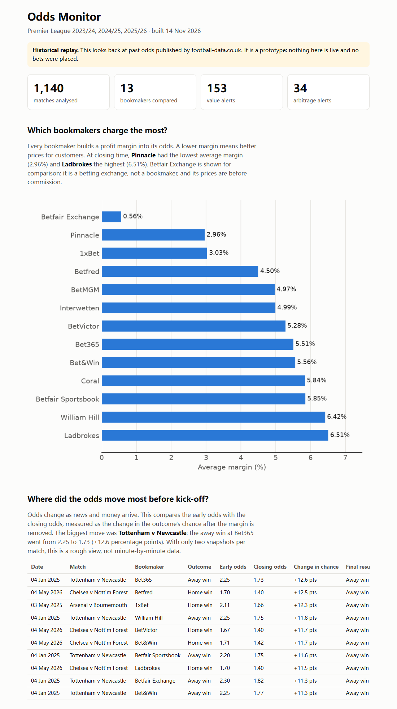

# Odds Monitor

**Bookmaker odds comparison, margin removal, discrepancy alerts and calibration, replayed on
three seasons of historical Premier League data.**

> ⚠️ **Prototype: historical replay only.** It analyses past odds published by
> football-data.co.uk. It is not connected to any live feed, places no bets and does no real
> trading. Built as a learning and interview project.



## What it does
| Question | How it answers it |
|---|---|
| How much margin does each bookmaker charge? | Overround per bookmaker and snapshot, ranked with a SQL window function |
| What is the *fair* probability of each outcome? | Removes the margin ("de-vig") from a sharp reference: **Pinnacle → Betfair Exchange → bookmaker average** |
| Which prices are out of line? | Flags a bookmaker when `fair_prob × odds − 1` exceeds a threshold (default 3%) |
| Is there a cross-book arbitrage? | Best price per outcome across bookmakers; flags when `Σ 1/best_odds < 1` |
| Where did the market move? | Early → closing price change per match/bookmaker/outcome using `LAG()` |
| Are the odds a good forecast? | Brier score, log loss and a reliability chart: proportional vs power de-vig, early vs closing odds |

There are three ways to look at the results:
1. **CLI:** five commands that print tables (for analysts).
2. **HTML report:** one self-contained page with charts and plain-English explanations. It opens in any browser and can be emailed (for non-technical readers).
3. **Streamlit dashboard:** an interactive version with season/bookmaker filters, an alert-threshold slider and hover tooltips.

## Quick start
Requires Python 3.11+ (developed on 3.13).
```bash
python -m venv .venv
.venv\Scripts\activate             # Windows  (macOS/Linux: source .venv/bin/activate)
pip install -r requirements-dev.txt

python scripts/download_data.py    # 3 Premier League seasons -> data/raw/
python cli.py ingest               # load into data/odds.duckdb
python cli.py report               # -> reports/report.html, open it in a browser
```

### CLI commands
```bash
python cli.py ingest                    # validate CSVs and load into DuckDB (idempotent: re-run inserts 0 rows)
python cli.py margins                   # average / median / min margin per bookmaker, ranked
python cli.py moves --limit 20 --bookmaker Pinnacle    # largest early -> closing moves
python cli.py alerts --threshold 0.03 --method power   # -> reports/alerts.csv + DuckDB alerts table
python cli.py calibrate                 # -> reports/calibration.png, calibration_summary.csv, reliability.csv
python cli.py report                    # -> reports/report.html (non-technical summary)
```

### Interactive dashboard
```bash
pip install -r requirements-app.txt     # adds Streamlit (optional)
streamlit run app.py                    # opens http://localhost:8501
```
The dashboard reads the DuckDB file read-only. Untick Pinnacle in the sidebar to see how the
alerts change when the sharp reference is missing.

## Data
- **Source:** [football-data.co.uk](https://football-data.co.uk/englandm.php), Premier League (`E0`),
  seasons 2023/24, 2024/25 and 2025/26: **1,140 matches**. Data files are not committed; the
  download script recreates them.
- `scripts/download_data.py` fetches `https://football-data.co.uk/mmz4281/<season>/E0.csv` (pattern checked
  against the index page). It skips files that exist, pauses between requests, reports the HTTP status and
  fails clearly on errors.
- **Bookmaker codes** follow the site's `notes.txt` and are mapped explicitly in `load.py`. Column names
  are ambiguous: `BFD` is Betfair *draw* but `BFDH` is *Betfred* home, and `VC`/`BV` are both BetVictor.
  `Max`/`Avg` are market aggregates, not bookmakers, so they are excluded.
- **Snapshots:** non-`C` columns are football-data's "pre-closing" odds, labelled `open`/"early" here
  (not a true market open); `C` columns are closing odds.

## Project structure
```
odds.py            implied prob, overround, proportional + power de-vig (bisection, no scipy)
load.py            read CSVs, validate (drop missing / odds <= 1, log counts), wide -> long
db.py              DuckDB schema (matches, odds_snapshots, alerts), idempotent ingest
queries.sql/.py    named SQL: margins (RANK), moves (LAG), odds joined with matches
detector.py        value edges vs sharp reference, cross-book arbitrage, dedupe
calibration.py     Brier, log loss, reliability table and plot
report.py          self-contained HTML report (charts embedded as PNG)
app.py             Streamlit dashboard (optional)
cli.py             argparse entry point
scripts/           download_data.py
tests/             pytest suite (38 tests, synthetic data, no network)
```

## Results on the three seasons
From the actual run (`python cli.py ...`):
- **Ingest:** 15,054 odds rows kept, 1,666 dropped for missing prices (none had odds ≤ 1).
- **Average closing margin:** Betfair Exchange 0.56% · Pinnacle 2.96% · 1xBet 3.03% · Bet365 5.51% · Ladbrokes 6.51%.
- **Alerts (3% threshold, power de-vig):** 153 value alerts across 111 matches (113 on closing odds, 40 on early odds),
  and 34 arbitrages with a median locked-in return of just 0.39%.
- **Calibration (same 1,140 matches):**

  | odds | method | Brier | log loss |
  |---|---|---|---|
  | early | proportional | 0.57411 | 0.96520 |
  | early | power | 0.57400 | 0.96463 |
  | closing | proportional | 0.57036 | 0.96044 |
  | closing | power | **0.57016** | **0.95986** |
  | baseline | always predict base rates | 0.64907 | 1.07225 |

  Closing beats early and power beats proportional, but the gaps are small and **not tested for significance**.

## Design choices
- **Power vs proportional de-vig:** proportional removes margin equally in relative terms, but bookmakers load
  more margin onto longshots (the favourite–longshot bias). Power (`p = q^k`) shrinks small probabilities more.
- **Idempotency:** natural primary keys plus `INSERT … ON CONFLICT DO NOTHING`. Alerts use the key
  `(type, match, snapshot, bookmaker, outcome)`, which also deduplicates them.
- **Betfair Exchange** is used as a fair-price reference but never as an alert target, because its quoted prices
  are before commission and would overstate edges.
- **Moves are measured in de-vigged probability**, so a bookmaker simply widening its margin does not look like a move.

## Known limitations
- **Two snapshots per match only.** "Moves" is a rough proxy for steam, not tick data.
- **Snapshot times differ between bookmakers**, so some arbitrages and edges are timing artefacts or stale quotes.
- **The reference can be wrong.** Leeds v Newcastle (30/08/2025): Pinnacle's closing home price was 3.16 while
  Betfair Exchange and seven bookmakers were at 3.25–3.90. That single price produced six value alerts and an arbitrage.
- **Pinnacle is missing after 08/01/2026.** Of those matches, 150 early snapshots use Betfair Exchange and 20 use the bookmaker
  average (which includes the book being tested, shrinking its edge).
- An edge against the reference is not proven profit: no stake limits, account restrictions or costs are modelled.
- `ON CONFLICT DO NOTHING` keeps the first version of a row; corrected source data would need `DO UPDATE` or versioning.
- Reliability bins above 80% hold few outcomes, so those points are noisy.

## What I'd change for production
- **Live feed ingestion:** a streaming consumer writing timestamped ticks instead of CSV batches.
- **Out-of-order and duplicate events:** upserts keyed on (event, book, market, source timestamp) with a watermark,
  so late ticks never overwrite newer prices.
- **Stale-feed detection:** track last update per book and market; suppress alerts on prices older than N seconds.
- **Reference sanity check:** require two sharp sources (e.g. Pinnacle and the exchange) to agree before alerting.
- **Rate limits:** a token bucket per provider, exponential backoff with jitter, caching.
- **Alert deduplication:** keep the dedupe key, but re-alert only on a material edge change; add cooldowns and routing.
- **Monitoring the monitor:** feed lag, rows per minute, alert rate and job health, and alarms when the pipeline goes quiet.

## Testing
```bash
pytest          # 38 tests: worked examples, de-vig sums, loader validation, idempotent ingest,
                # SQL window queries, arbitrage/mispricing detection, calibration maths, CLI, dashboard
ruff check .
```
The dashboard tests are skipped automatically if Streamlit is not installed.

## Credits
Odds and results data: [football-data.co.uk](https://www.football-data.co.uk/). Use it in line with their terms.
