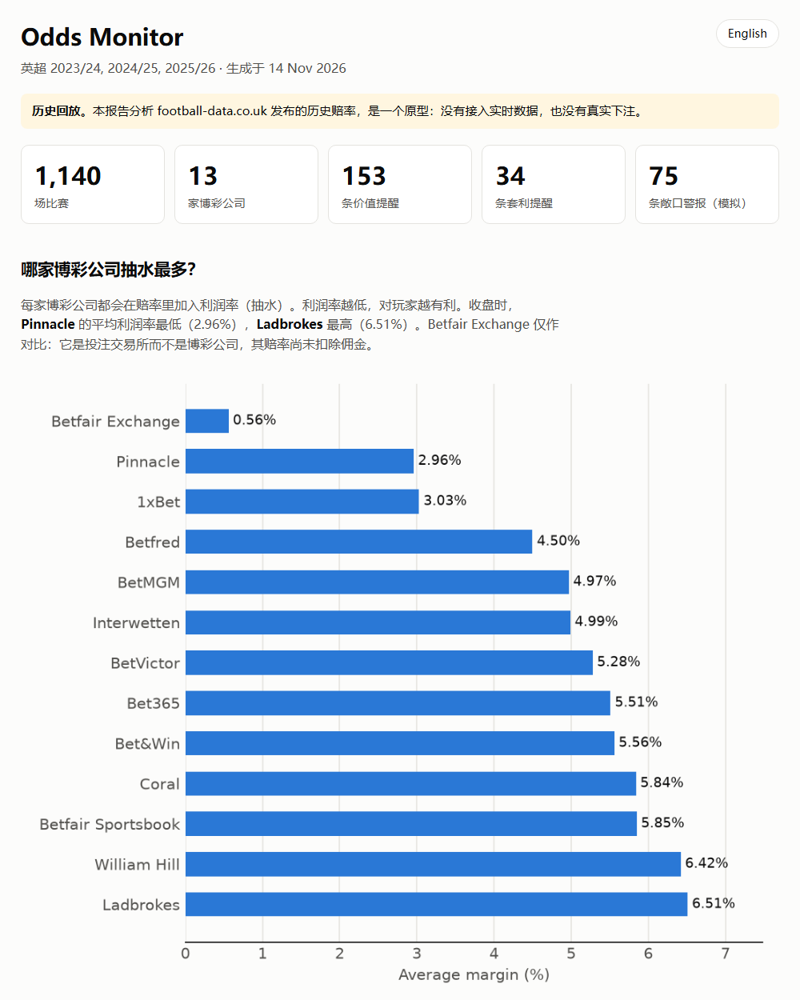

# Odds Monitor（赔率监控）

[English](README.md) | **中文**

[](https://github.com/yuhang-deng-cs/Odds_Monitor/actions/workflows/ci.yml)


[](LICENSE)

**基于三个赛季英超历史数据回放的赔率分析工具：博彩公司赔率对比、去水（去除利润率）、
定价偏差提醒、收盘价值（CLV）检验、模拟庄家风险敞口，以及赔率准确度（校准）评估。**

> ⚠️ **原型：仅做历史回放。** 分析的是 football-data.co.uk 公布的历史赔率，没有接入任何实时数据，
> 不下注，也不做真实交易。这是一个学习和面试项目。



## 主要发现
以下均为三个赛季的真实运行结果（细节和局限见[三个赛季的结果](#三个赛季的结果)）：
- **利润率从 0.56% 到 6.51% 不等。** 收盘平均利润率：Betfair Exchange 0.56%、Pinnacle 2.96%、Bet365 5.51%、Ladbrokes 6.51%。
- **大部分“价值”只是一家专业公司与市场意见不同。** 在有交易所报价的 119 条以 Pinnacle 为参考的提醒中，只有 21 条相对 Betfair Exchange 仍超过 3%。要求两者一致是自然的改进：其中 3 条早盘提醒全部跑赢收盘价（CLV +4.9%），但 21 注还不能说明能否盈利（−45%，区间 −89% … +13%）。
- **收盘赔率的提醒是亏钱的：** 每单位下注 −43%（95% 区间 −70% … −6%）。早盘提醒有 60% 优于收盘价，而普通早盘赔率只有 20%，但只有 40 注。
- **模拟庄家**（以 Bet365 收盘赔率为我方价格）：预期利润为投注额的 5.2%（接近其 5.51% 的利润率），按真实赛果为 4.5%；1,140 场中有 75 场超过 10,000 单位的敞口限额。
- **套利稀少且很薄：** 共 34 次，锁定回报中位数 0.39%。

## 功能
| 问题 | 解决方法 |
|---|---|
| 每家博彩公司抽多少水？ | 按博彩公司和时点计算超额率（overround），用 SQL 窗口函数排名 |
| 每个结果的*公平*概率是多少？ | 从专业参考价中去掉利润率（"de-vig"：比例法、power 法或 Shin 法），参考价顺序：**Pinnacle → Betfair Exchange → 博彩公司平均值** |
| 哪些赔率偏离市场？ | 当 `公平概率 × 赔率 − 1` 超过阈值（默认 3%）时发出提醒 |
| 是否存在跨公司套利？ | 取每个结果在各家的最佳赔率，当 `Σ 1/最佳赔率 < 1` 时提醒 |
| 市场如何变动？ | 用 `LAG()` 计算每场比赛/博彩公司/结果从早盘到收盘的变化 |
| 提醒经得起检验吗？ | 早盘提醒的**收盘价值（CLV）**与全部早盘赔率基准对比；用真实赛果做固定注额回测，按整场比赛 bootstrap 求区间；再用 Betfair Exchange 做第二参考源复核：交易所也同意时提醒标记为*已确认*，已确认的提醒单独回测 |
| 如果我们是庄家，一场比赛最多会亏多少？ | 以某博彩公司的真实收盘赔率为“我们的”价格，**模拟**投注：每个结果的负债、每场最坏情况、超过限额的敞口警报，以及职业玩家利用错误定价带来的成本 |
| 赔率是好的预测吗？ | Brier 分数、对数损失和校准图：比例法 vs power 法 vs Shin 法去水，早盘 vs 收盘 |

三种查看结果的方式：
1. **命令行（CLI）：** 打印表格的命令（给分析人员）。
2. **HTML 报告：** 一个独立的网页，包含图表和通俗解释，任何浏览器都能打开，可以直接发邮件（给非技术读者）。
3. **Streamlit 看板：** 交互版本，可以按赛季/博彩公司筛选，调整提醒阈值和敞口限额，鼠标悬停查看详情，还有一个适用于任意盘口（例如赛马）的赔率计算器。

报告和看板都有 **English / 中文 语言切换**（默认英文）。

## 快速开始
需要 Python 3.11+（开发环境为 3.13）。
```bash
python -m venv .venv
.venv\Scripts\activate             # Windows（macOS/Linux：source .venv/bin/activate）
pip install -r requirements-dev.txt

python cli.py download             # 下载 3 个英超赛季 -> data/raw/
python cli.py ingest               # 导入 data/odds.duckdb
python cli.py report               # -> reports/report.html，用浏览器打开
```

> **Windows PowerShell：** 如果激活时提示“running scripts is disabled”，先运行一次
> `Set-ExecutionPolicy -Scope CurrentUser RemoteSigned`；或者不激活，直接调用虚拟环境里的 Python：
> `.\.venv\Scripts\python.exe cli.py report`。出现 `ModuleNotFoundError: No module named 'duckdb'`
> 说明命令没有在虚拟环境中运行。

### 命令行
```bash
python cli.py download                  # 下载各赛季 CSV（已存在的文件会跳过）
python cli.py ingest                    # 校验 CSV 并导入 DuckDB（幂等：重复运行插入 0 行）
python cli.py margins                   # 每家博彩公司的平均/中位/最小利润率，排名
python cli.py moves --limit 20 --bookmaker Pinnacle    # 早盘 -> 收盘变动最大的赔率
python cli.py alerts --threshold 0.03 --method power   # -> reports/alerts.csv（含 confirmed 列）+ DuckDB alerts 表
python cli.py clv --method shin          # 所有带 --method 的命令都支持 proportional / power / shin
python cli.py clv                       # 价值提醒的收盘价值 + 回测
python cli.py exposure --book Bet365 --limit 10000     # 模拟每场比赛的负债
python cli.py devig 3.0 4.5 6.0 8.0 10.0 13.0          # 任意盘口（如赛马）的利润率和公平赔率
python cli.py calibrate                 # -> reports/calibration.png、calibration_summary.csv、reliability.csv
python cli.py report                    # -> reports/report.html（面向非技术读者的总结）
```

### 交互看板
```bash
streamlit run app.py                    # 打开 http://localhost:8501
```
在全新的克隆（或全新的云端部署）上，看板首次运行时会自己下载数据并建立数据库，所以只需要
`streamlit run app.py`。看板以只读方式读取 DuckDB 文件。在侧边栏取消勾选 Pinnacle，可以看到缺少专业参考价时提醒会怎样变化。

## 数据
- **来源：** [football-data.co.uk](https://football-data.co.uk/englandm.php)，英超（`E0`），
  2023/24、2024/25、2025/26 三个赛季，共 **1,140 场比赛**。数据文件不提交到仓库，用下载脚本重新生成。
- `python cli.py download`（`download.py`）下载 `https://football-data.co.uk/mmz4281/<season>/E0.csv`（链接格式已与网站索引页核对）。
  已存在的文件会跳过，每次请求之间会暂停，报告 HTTP 状态码，出错时给出明确提示。
- **博彩公司代码**依据网站的 `notes.txt`，在 `load.py` 中逐一映射。列名容易混淆：`BFD` 是 Betfair 的*平局*，
  而 `BFDH` 是 *Betfred* 的主胜；`VC`/`BV` 都是 BetVictor。`Max`/`Avg` 是市场汇总值，不是博彩公司，因此排除。
- **时点：** 不带 `C` 的列是 football-data 的“收盘前”赔率，这里标为 `open`/“早盘”（并非真正的开盘价）；
  带 `C` 的列是收盘赔率。

## 项目结构
```
odds.py            隐含概率、超额率、比例法 / power 法 / Shin 法去水（二分法，不依赖 scipy），任意盘口公平赔率表
load.py            读取 CSV，校验（删除缺失值 / 赔率 <= 1，并记录数量），宽表 -> 长表
db.py              DuckDB 表结构（matches、odds_snapshots、alerts），幂等导入
queries.sql/.py    命名 SQL：margins（RANK）、moves（LAG）、赔率关联比赛
detector.py        相对专业参考价的价值优势、跨公司套利、去重
clv.py             收盘价值、固定注额回测、按比赛 bootstrap、交易所复核
liability.py       模拟庄家账簿：每个结果的负债、最坏情况、敞口警报
i18n.py            报告和看板共用的中英文标签
calibration.py     Brier、对数损失、校准表和图
report.py          独立 HTML 报告（图表以 PNG 内嵌）
download.py        礼貌、幂等的下载器（保存前校验每个文件）
app.py             Streamlit 看板（首次运行时自动建库）
cli.py             argparse 命令行入口
tests/             pytest 测试（61 个，使用合成数据，不联网）
.github/workflows/ CI：在 Python 3.11 和 3.13 上运行 ruff 检查、格式检查和 pytest
```

## 三个赛季的结果
以下均来自实际运行（`python cli.py ...`）：
- **导入：** 保留 15,054 行赔率，因缺失价格删除 1,666 行（没有赔率 ≤ 1 的行）。
- **收盘平均利润率：** Betfair Exchange 0.56% · Pinnacle 2.96% · 1xBet 3.03% · Bet365 5.51% · Ladbrokes 6.51%。
- **提醒（3% 阈值，power 去水）：** 111 场比赛共 153 条价值提醒（收盘 113 条，早盘 40 条），
  以及 34 次套利，锁定收益中位数只有 0.39%。
- **校准（同样 1,140 场）：**

  | 赔率 | 方法 | Brier | 对数损失 |
  |---|---|---|---|
  | 早盘 | 比例法 | 0.57411 | 0.96520 |
  | 早盘 | power | 0.57400 | 0.96463 |
  | 早盘 | Shin | 0.57399 | 0.96471 |
  | 收盘 | 比例法 | 0.57036 | 0.96044 |
  | 收盘 | power | **0.57016** | **0.95986** |
  | 收盘 | Shin | 0.57020 | 0.96000 |
  | 基准 | 总是按历史主/平/客比例预测 | 0.64907 | 1.07225 |

  收盘优于早盘；power 法和 Shin 法都优于比例法，两者之间几乎持平。差距很小，且**没有做显著性检验**。
- **提醒经得起检验吗？**（`python cli.py clv`）

  | 分组 | 数量 | 有 CLV 的注数 | 平均 CLV | 跑赢收盘 | 每单位回报 | 95% 区间 |
  |---|---|---|---|---|---|---|
  | 早盘价值提醒 | 40 | 40 | −0.6% | 60% | +15.4% | −54% … +99% |
  | 收盘价值提醒 | 113 | 0 | – | – | −43.0% | −70% … −6% |
  | 交易所确认的提醒 | 21 | 3 | +4.9% | 100% | −44.7% | −89% … +13% |
  | 全部早盘赔率（基准） | 20,421 | 20,421 | −6.2% | 20% | −6.4% | −9% … −4% |

  早盘提醒远好于一般早盘赔率（60% vs 20% 跑赢收盘），但平均来说还没跑赢收盘价本身；其回测样本太小，
  无法区分能力和运气。收盘提醒**即使考虑运气也是亏损的**。第二参考源复核解释了原因：在以 Pinnacle 为参考、
  且有交易所报价的 119 条提醒中，只有 **21** 条相对 Betfair Exchange 仍超过 3%，也就是说大多数提醒只是
  Pinnacle 单独与市场不一致。“交易所确认的提醒”一行只回测这 21 条（3 条早盘、18 条收盘）：早盘的几条全部跑赢收盘价，
  但 21 注不足以说明“两个参考源一致”的规则能否赚钱。区间按整场比赛重抽样，因为一个异常报价可能同时触发多条提醒。
- **模拟风险敞口**（`python cli.py exposure`，以 Bet365 收盘赔率作为“我们的”价格，每场 10,000 单位普通投注，
  当我们的价格比公平价高出 3% 以上时职业玩家加注 2,000，限额 10,000）：
  预期利润 591,402，总投注 11,422,000（5.2%，接近 Bet365 5.51% 的利润率），按真实赛果利润 517,448；
  **1,140 场中有 75 场**超过限额。职业玩家在 11 场比赛下注，对庄家的预期成本为 1,525；按真实赛果庄家反而赚了
  22,000，但只有 11 注，这是运气。*投注是模拟的，赔率和赛果是真实的。*

## 设计取舍
- **power 法 vs 比例法去水：** 比例法按相同比例去掉每个结果的利润率，但博彩公司在冷门上加的利润率更多
  （热门-冷门偏差）。power 法（`p = q^k`）对小概率压缩得更多。**Shin 法**假设有比例为 `z` 的资金来自内幕知情者并求解 `z`；
  在只有两个结果时，它等价于从两边减去相同的绝对值（有测试验证）。在这份数据上 power 法和 Shin 法几乎持平。
- **幂等性：** 自然主键 + `INSERT … ON CONFLICT DO NOTHING`。提醒以 `(类型, 比赛, 时点, 博彩公司, 结果)` 为键，同时实现去重。
- **Betfair Exchange** 只作为公平价参考，从不作为提醒对象，因为它的报价未扣佣金，会高估优势。
- **赔率变动用去水后的概率衡量**，这样博彩公司单纯加大利润率不会被误判为价格变动。
- **同一条提醒的两种视角：** 对玩家来说价值提醒是机会；对博彩公司来说，它是*我们自己*会被职业玩家盯上的价格。
  敞口模拟把这一点连了起来：职业玩家的投注正好出现在检测器触发的地方。
- **先看 CLV，再看盈亏：** 几百注的实际盈亏主要是噪声；收盘价值是判断价格对错的更快的标准信号。两者都报告，并给出真实的区间。
- **不局限于足球：** 去水和利润率函数接受任意数量的结果，所以同一套代码可以给 10 匹马的赛事定价：
  试试 `python cli.py devig ...` 或看板的*赔率计算器*标签页（预填的是示例赛事，不是真实数据；测试见 `tests/test_odds.py`）。
  真正做赛马还需要处理位置盘、退赛扣减（Rule 4）和 each-way 条款。

## 已知局限
- **每场比赛只有两个时点。** “变动”只是对 steam（大资金推动的变盘）的粗略近似，不是逐笔数据。
- **各博彩公司的报价时间不同**，所以部分套利和优势是时间差或过时报价造成的。
- **参考价可能出错。** Leeds v Newcastle（2025/08/30）：Pinnacle 的收盘主胜赔率为 3.16，而 Betfair Exchange 和
  七家博彩公司在 3.25–3.90 之间。这一个报价就产生了六条价值提醒和一次套利。
- **2026/01/08 之后缺少 Pinnacle。** 这些比赛中，150 个早盘时点使用 Betfair Exchange，20 个使用博彩公司平均值
  （平均值包含被检验的博彩公司本身，会缩小其优势）。
- 相对参考价的优势不等于真实利润：没有考虑投注限额、账户限制或成本。
- **敞口数字是模拟的。** 数据中没有投注；投注规模、波动大小和职业玩家规则都是假设，只有赔率和赛果是真实的。
- CLV 和回测样本较小（早盘提醒 40 条，收盘提醒 113 条），所以区间很宽。
- `ON CONFLICT DO NOTHING` 保留第一次写入的行；如果源数据被更正，需要 `DO UPDATE` 或版本管理。
- 80% 以上的校准区间样本很少，这些点波动较大。

## 生产环境会怎么改
- **实时数据接入：** 用流式消费者写入带时间戳的逐笔数据，替代 CSV 批量导入。
- **乱序和重复事件：** 以（赛事、博彩公司、盘口、源时间戳）为键做 upsert，并使用 watermark，保证迟到的数据不会覆盖更新的价格。
- **过时数据检测：** 记录每家博彩公司每个盘口的最后更新时间；价格超过 N 秒未更新则不发提醒。
- **参考价复核：** 只推送两个专业参考源都同意的提醒（`confirmed` 标记已经算好），并持续积累样本，直到足以判断。
- **限流：** 每个数据源一个令牌桶，指数退避加随机抖动，加缓存。
- **提醒去重：** 保留去重键，但只在优势发生实质变化时重新提醒；加冷却时间和分发路由。
- **监控监控系统本身：** 数据延迟、每分钟行数、提醒频率和任务健康状况，管道静默时报警。

## 测试
```bash
pytest          # 61 个测试：手算例子、去水求和（含 10 匹马赛事）、Shin 去水、双参考源确认、导入校验、幂等导入、SQL 窗口查询、
                # 套利/错误定价检测、CLV 和 bootstrap、负债计算、校准、下载器、CLI、看板（含语言切换和首次建库）
ruff check . && ruff format --check .
```
每次推送时，GitHub Actions 会自动运行同样的检查。

## 许可与致谢
代码：[MIT](LICENSE)。赔率和赛果数据：[football-data.co.uk](https://www.football-data.co.uk/)；本仓库不转载数据，
使用须遵守其条款。
